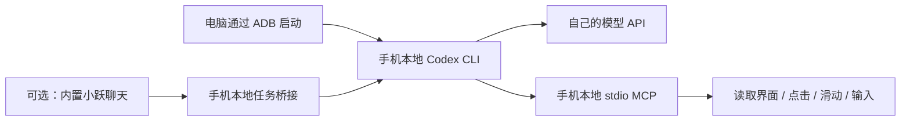

# 在 Android 手机上运行 Codex CLI，并用 MCP 控制这台手机

在手机的 ADB shell 里跑 Codex CLI，把界面读取、点击、滑动和输入封装成 MCP 工具，让模型自己驱动这台手机。**不需要 root，不需要厂商 GUI Agent，也不需要进入厂商的 Ubuntu rootfs。**

实测基线：**Android 16、ARM64、ADB shell UID 2000、无 root**。其他机型和系统版本需要重新验证。固定使用已验证的 **Codex CLI 0.163.0**，这不是“最新版安装器”，也不代表 OpenAI 官方的 Android 支持说明。

已验证的完整链路（2026-10-25，STEPX Neo `PZ261A`）：

```
手机本地 Codex CLI  →  自配 Responses API（阶跃 Step Plan）
                    →  本地 stdio MCP（stepneo-phone）
                    →  UiAutomation / 截图 / 坐标注入  →  真机界面
```

- [INSTALL-MACOS.md](INSTALL-MACOS.md) — 从零安装到第一次只读调用
- [STEPFUN-NOTES.md](STEPFUN-NOTES.md) — 接入非 OpenAI 模型（阶跃 Step Plan）的三个必解问题
- [HARDENING.md](HARDENING.md) — 相比社群分享版本改了什么，为什么改
- [VERIFICATION.md](VERIFICATION.md) — 哪些是实测通过，哪些仍未验证

## 安全档位

写操作默认受限，可以按任务逐步放开：

| 档位 | 能力 | 适用场景 |
| --- | --- | --- |
| `observe` | 状态、能力探测、查找、等待、UI 树、截图 | 看清屏幕，不产生任何操作 |
| `assist` | 精确文字点击、输入、滑动、导航键、打开受控 URL | 有人值守的日常任务；隐藏坐标点击与 `ENTER`/`DPAD_CENTER`，拦截支付/删除/授权类动作 |
| `full` | 全部工具，含坐标点击与提交键 | 明确的受控测试，不应作为日常默认 |

另有一次性配对码、浏览器 Origin 拒绝、任务执行显式开关、审计日志不记录输入正文与 URL 等加固项，详见 [HARDENING.md](HARDENING.md)。

## 快速开始

1. 手机开启开发者选项与 USB 调试，用数据线连接电脑。
2. 按 [INSTALL-MACOS.md](INSTALL-MACOS.md) 上传 CLI、脚本、JAR 与配置。
3. 在自己的终端隐藏输入模型 Key（不要写进文件或聊天）。
4. 先用 `observe` 档跑一次只读调用，确认能读到界面。

本仓库不含模型 Key、登录文件、客户端令牌、设备序列号或聊天记录，使用者需要配置自己的接口和凭据。

## 目录结构

```
phone/     手机侧脚本：CLI 启动器、网络代理、stdio MCP、UI helper
optional/  可选的小跃任务桥接（客户端、jq 过滤器、桥接脚本）
src/       UI helper 的 Java 源码与重建说明
templates/ 配置模板（主配置、exec/assist/bridge profile、模型目录、安全策略）
tests/     Shell 与 Python 层的无设备自动化测试
scripts/   打包脚本
```

## 来源与致谢

本项目源自社群其他用户分享的《手机安装 Codex CLI，并通过 MCP 控制手机》方案。原分享者完成了首次实机打通；本项目在此基础上补充了配对码、Origin 拒绝、安全档位、任务执行开关、敏感操作拦截、结构化查找/等待/能力探测等加固项，并解决了非 OpenAI 模型接入时 MCP 工具不可见的兼容问题。

社群分享的原始版本未随本仓库发布，其文件与校验值可在 [VERIFICATION.md](VERIFICATION.md) 中查到；如需补充上游链接或调整署名，欢迎提 issue 或直接联系仓库维护者。

Codex CLI 与 MCP 规范分别归 OpenAI 与 Anthropic 所有，本仓库与两者无隶属关系。

## 许可

MIT，见 [LICENSE](LICENSE)。使用前请阅读 [SECURITY.md](SECURITY.md)：这套方案在 ADB shell 身份下运行，权限高于普通第三方 App，请只用于自己拥有或已获授权的设备。

## 工作原理



核心是：**在 Android shell 中运行 Codex，把手机操作封装为 MCP 工具，让模型调用工具。** CLI 安装在 `/data/local/tmp/stepneo-codex`，不需要进入厂商的 Ubuntu rootfs。它没有解锁厂商 GUI Agent 或原生 MCP。

| 部件 | 作用 |
|---|---|
| `phone/codex` | 设置运行目录、网络和证书，启动手机 CLI |
| `phone/network.sh`、`provider-connect.sh` | 由 Android 处理模型服务域名解析，保留端到端 TLS 校验 |
| `phone/phone-mcp.sh` | 提供手机 UI、查找、等待、能力探测和受控地址打开工具，使用 stdio，不监听网络端口 |
| `phone/phone-ui-helper.jar` | 读取可访问性树、处理截图尺寸、点击控件和 Unicode 输入 |
| `templates/config.toml` | 不含凭据的配置模板 |
| `templates/bridge.config.toml` | 仅桥接任务使用的显式 opt-in 配置 |
| `templates/exec.config.toml` | 首次非交互读取验收的三只读工具配置 |
| `templates/assist.config.toml` | 显式 opt-in 的非交互辅助操作配置 |
| `templates/phone-policy.txt` | 辅助档的包名与敏感操作拦截规则 |
| `optional/` | 内置小跃委托使用的可选任务桥接与客户端 |
| `src/` | UI helper 源码和构建说明 |

## 1. 准备环境

电脑需要 `adb`、Python 3 和可用的 `tar`。手机打开开发者选项及 USB 调试，授权这台电脑，解锁屏幕。先从有线 USB 开始，方便排错。

在解压后的分享目录打开 PowerShell：

```powershell
adb devices
$device = Read-Host '输入上面列表中你自己的设备序列号'
adb -s $device shell id
adb -s $device shell getprop ro.product.cpu.abi
adb -s $device shell getprop ro.build.version.release
adb -s $device shell 'command -v app_process; command -v nc; command -v flock; command -v timeout'
```

下面步骤要求 ARM64。`id` 应能取得 shell 身份；如果设备不允许 shell 截图、注入输入或使用 UiAutomation，单纯安装 CLI 不能补出这些权限。所需 `nc` 是这次设备上带 `-L`、`-W` 参数的 Android 实现；其他设备先核对 `nc --help`。

## 2. 下载已验证版本的官方原生包和 jq

下载在电脑上进行，手机侧直接执行原生二进制，不依赖手机安装 Node.js。以下包名及布局来自本次实际安装的 npm 原生包：

```powershell
New-Item -ItemType Directory -Force -Path downloads | Out-Null
Invoke-WebRequest -Uri 'https://registry.npmjs.org/@openai/codex/-/codex-0.163.0-linux-arm64.tgz' -OutFile '.\downloads\codex.tgz'
Invoke-WebRequest -Uri 'https://github.com/jqlang/jq/releases/download/jq-1.8.2/jq-linux-arm64' -OutFile '.\downloads\jq'

$sha512 = [Security.Cryptography.SHA512]::Create()
try {
    $actual = [Convert]::ToBase64String($sha512.ComputeHash([IO.File]::ReadAllBytes((Join-Path $PWD 'downloads\codex.tgz'))))
} finally {
    $sha512.Dispose()
}
$expected = 'IH2/R+4OarjGvsAf1ll3fdyLwrPgYLl3uzp6u9CyD9sj2Lw+ViDSe3QBZVHdcHJs0eIiZFg6Wprcuy4CRZaUGw=='
if ($actual -cne $expected) { throw 'Codex 下载包校验不一致，请停止' }
if ((Get-FileHash '.\downloads\jq' -Algorithm SHA256).Hash.ToLowerInvariant() -ne '8b85c817833814ddca00a144c33705546355afccf0cf39b188f3cdb48b852309') { throw 'jq 校验不一致，请停止' }

tar -xzf '.\downloads\codex.tgz' -C '.\downloads'
if ($LASTEXITCODE -ne 0) { throw '解压失败' }
$vendor = Join-Path $PWD 'downloads\package\vendor\aarch64-unknown-linux-musl'
```

升级版本需要重新核对布局和 Android 兼容性，不能只替换版本号后沿用这里的校验值。

## 3. 填自己的模型接口

先编辑两个文件，再上传：

1. `templates/config.toml`：把 `YOUR_MODEL_ID` 换为自己的接口实际提供的模型 ID，把 `https://api.example.com/v1` 换为自己的 **Responses API** 地址。
2. `phone/provider-connect.sh`：把两处 `api.example.com` 都换为上面地址的域名，只写域名，不带 `https://`、路径或端口。本模板固定 HTTPS 443。

CLI 使用 `wire_api = "responses"`。服务仅宣称“兼容 OpenAI”或只提供 `/chat/completions`，不代表能直接用于此方案。需要实际支持 Responses 流式响应及工具调用；看截图还需要模型和接口支持图片输入。

推理强度按服务商支持的值填写。模板没有强制设置；本次另一套配置验证过 `deepseek-v4.1-flash` 配合 `max`，这是特定接口的结果，不代表任意 DeepSeek 接口或模型均接受 `max`。

**不要把 Key 写进 TOML、脚本、提示词或群聊。** 后面用 CLI 的标准输入完成登录。

## 4. 上传 CLI、运行脚本和 MCP

以下用于新手机首次安装；已有同目录安装时，先保留原配置和凭据，避免直接覆盖。

```powershell
$phoneRoot = '/data/local/tmp/stepneo-codex'
adb -s $device shell "mkdir -p $phoneRoot/bin $phoneRoot/codex-path $phoneRoot/codex-resources $phoneRoot/home $phoneRoot/config $phoneRoot/tmp $phoneRoot/workspace"
adb -s $device shell "chmod 700 $phoneRoot $phoneRoot/home $phoneRoot/config $phoneRoot/tmp $phoneRoot/workspace"

adb -s $device push "$vendor\bin\codex" "$phoneRoot/bin/codex"
adb -s $device push "$vendor\bin\codex-code-mode-host" "$phoneRoot/bin/codex-code-mode-host"
adb -s $device push "$vendor\codex-path\rg" "$phoneRoot/codex-path/rg"
adb -s $device push "$vendor\codex-resources\bwrap" "$phoneRoot/codex-resources/bwrap"
adb -s $device push "$vendor\codex-package.json" "$phoneRoot/codex-package.json"
adb -s $device push '.\downloads\jq' "$phoneRoot/bin/jq"

adb -s $device push '.\phone\codex' "$phoneRoot/codex"
adb -s $device push '.\phone\network.sh' "$phoneRoot/network.sh"
adb -s $device push '.\phone\provider-connect.sh' "$phoneRoot/provider-connect.sh"
adb -s $device push '.\phone\phone-mcp.sh' "$phoneRoot/phone-mcp.sh"
adb -s $device push '.\phone\phone-ui-helper.jar' "$phoneRoot/phone-ui-helper.jar"
adb -s $device push '.\templates\config.toml' "$phoneRoot/config/config.toml"
adb -s $device push '.\templates\phone-policy.txt' "$phoneRoot/config/phone-policy.txt"
adb -s $device push '.\templates\bridge.config.toml' "$phoneRoot/config/bridge.config.toml"
adb -s $device push '.\templates\exec.config.toml' "$phoneRoot/config/exec.config.toml"
adb -s $device push '.\templates\assist.config.toml' "$phoneRoot/config/assist.config.toml"
adb -s $device shell "chmod 700 $phoneRoot/codex $phoneRoot/network.sh $phoneRoot/provider-connect.sh $phoneRoot/phone-mcp.sh $phoneRoot/bin/codex $phoneRoot/bin/codex-code-mode-host $phoneRoot/bin/jq"
adb -s $device shell "chmod 600 $phoneRoot/config/config.toml $phoneRoot/config/phone-policy.txt $phoneRoot/config/bridge.config.toml $phoneRoot/config/exec.config.toml $phoneRoot/config/assist.config.toml $phoneRoot/phone-ui-helper.jar"
```

留意每条 `adb push` 的返回结果，出现失败就先排查。脚本必须保持 LF 换行；不要用文本管道传 JAR 或其他二进制。

先做不调用模型的检查：

```powershell
adb -s $device shell "$phoneRoot/codex --version"
adb -s $device shell "$phoneRoot/codex mcp list --json"
adb -s $device shell "CLASSPATH=$phoneRoot/phone-ui-helper.jar app_process / PhoneUiHelper geometry"
adb -s $device shell "CLASSPATH=$phoneRoot/phone-ui-helper.jar app_process / PhoneUiHelper ui"
```

应看到 CLI 版本、`stepneo-phone` 配置，以及当前屏幕尺寸和 UI 数据。`mcp list` 本身只说明已配置，最后两条和实际工具调用用于确认 helper 能运行。Codex 启动的 Java 子进程需要 Android 的运行环境，因此模板显式转发了公开的 `BOOTCLASSPATH` 等变量，不要随手删掉。

手机端的默认安全档是 `assist`。它仍允许读取、启动应用、点击精确文字、输入，以及查找、等待和打开受控 HTTP(S) 地址，但要求 `phone_click` / `phone_input` 明确携带 package，阻止坐标点击、Enter/DPAD_CENTER、设置/Alipay 包以及一组支付、删除、授权和发送类文字。`observe` 允许状态、能力探测、UI、查找、等待和截图。`full` 才会放开坐标点击和提交键，必须在充分知情后显式启用。

## 5. 私密输入自己的 API Key

电脑使用 Python 的隐藏输入，Key 通过子进程标准输入送到手机 CLI，不出现在命令行参数中：

```powershell
@'
import getpass
import subprocess
import sys

device = sys.argv[1]
key = getpass.getpass('输入你自己的 API Key（不回显）：')
if not key.strip():
    raise SystemExit('没有输入 Key')
result = subprocess.run(
    ['adb', '-s', device, 'shell', '-T',
     '/data/local/tmp/stepneo-codex/codex', 'login', '--with-api-key'],
    input=(key + '\n').encode('utf-8'),
    check=False,
)
del key
raise SystemExit(result.returncode)
'@ | python - $device

adb -s $device shell "$phoneRoot/codex login status"
adb -s $device shell "chmod 600 $phoneRoot/config/auth.json"
```

登录文件会保存在这部手机的 `config/auth.json`。不要打开它截图、发给别人或提交到仓库。它位于 shell 专用目录，不是厂商 App 的私有数据目录；已经授权的 ADB shell 可以访问它。

## 6. 让 Codex 真正调用手机工具

先做读取测试。为避免 Windows 到 Android 的中文及引号转义问题，提示词用 UTF-8 无 BOM 文件传递：

```powershell
$promptPath = Join-Path $PWD 'check-prompt.txt'
[IO.File]::WriteAllText($promptPath, '只使用 stepneo-phone MCP 的 phone_status、phone_ui 和 phone_screenshot，概述当前页面，不点击或输入，不读取凭据。', [Text.UTF8Encoding]::new($false))
adb -s $device push $promptPath "$phoneRoot/workspace/check-prompt.txt"
adb -s $device shell "STEPNEO_PHONE_PROFILE=observe $phoneRoot/codex exec --json --profile exec --skip-git-repo-check --sandbox read-only --color never - < $phoneRoot/workspace/check-prompt.txt"
```

这一步开始会产生自己模型接口的正常用量。确认读取正常后，手动打开一个无敏感内容的测试输入框，把提示词换为：

> 只使用 stepneo-phone MCP。先读取 UI，找到当前唯一的测试输入框，使用 phone_input 写入“中文输入测试 ABC 123”，核对精确回读，再截图。不要按 Enter，不要搜索、发送或提交；找不到可靠输入框就停止并说明。

重新写入同一个本地提示词文件并 `adb push` 后执行；这一步需要显式使用 `--profile assist`，它仍是自动批准的无人值守配置，而不是人工交互确认：

```powershell
adb -s $device shell "$phoneRoot/codex exec --json --profile assist --skip-git-repo-check --sandbox read-only --color never - < $phoneRoot/workspace/check-prompt.txt"
```

`assist.config.toml` 仍只启用辅助档工具，MCP 本身会隐藏坐标点击和 Enter。要使用 `full`，必须另外创建并审核对应 profile；不要把 `full` 设为默认。

模板对人工交互使用 `approval_policy = "on-request"` 和交互工具 `approval_mode = "prompt"`。`--sandbox read-only` 只限制 CLI shell 文件系统，**不等于禁止 MCP 操作手机**；手机 MCP 仍按 ADB shell 权限执行。加固版的工具档位和政策是应用层防线，不是无法绕过的 Android 系统级授权。

## 工具怎么用

| 工具 | 用法 |
|---|---|
| `phone_status` | 读取手机身份、原屏与图片尺寸 |
| `phone_capabilities` | 探测版本、ABI、shell 身份、显示和依赖是否可用 |
| `phone_ui` | 读取当前可访问性节点和图像坐标 bounds |
| `phone_find` | 按精确文字、resource_id 或 package 查找节点，不执行动作 |
| `phone_wait` | 等待节点出现或消失，最多 15 秒 |
| `phone_screenshot` | 返回实际屏幕 PNG，默认不存系统图库 |
| `phone_tap` | 默认接收图片像素坐标，自动换算原屏 |
| `phone_swipe` | 同样默认使用图片坐标 |
| `phone_key` | HOME、BACK、ENTER 等有限按键 |
| `phone_launch` | 按包名解析真实 launcher，或使用已核对的组件 |
| `phone_open_url` | 让系统用默认浏览器打开一个经校验的 HTTP(S) 地址 |
| `phone_click` | 按唯一 `resource_id` 或目标文字点击，可限制包名 |
| `phone_input` | `ACTION_SET_TEXT` 输入 Unicode，支持 replace/append，精确回读 |

输入优先“读取 UI → 点击唯一目标或指定输入框 → `phone_input` → 验证”。不要让模型逐个点击软键盘来拼中文。输入工具不自动发送，也不把输入文本作为 shell 命令执行。

UI 和截图已经统一为图片坐标，**不要手动再缩放**。确实持有原屏坐标时，显式传 `coordinate_space="screen"`。不要写死别人手机的分辨率。

## 常见问题与边界

| 现象 | 检查方向 |
|---|---|
| 有 Ubuntu rootfs，为什么不进去安装？ | 本方案用 Android shell；rootfs 存在不代表普通 ADB 有进入权限 |
| CLI 能打印版本，但请求失败 | 核对 Responses 兼容性、模型 ID、自己的 Key、域名白名单及系统 CA 路径 |
| CONNECT 返回 403 | `provider-connect.sh` 的两处域名与 TOML 的 HTTPS 域名不一致，或用了非 443 端口 |
| `bwrap`、`rg` 或 git 不可用 | 本机 Linux 沙箱及随包部分工具不兼容 Android；MCP 控屏实测成功不代表完整 Linux 编程环境可用 |
| UI 返回空、输入失败 | 解锁屏幕并确认当前应用；自绘控件、不暴露可访问性节点的输入框可能无法使用 `ACTION_SET_TEXT` |
| 截图看得到，UI 文本为空 | 可能是自绘界面，应结合截图判断 |
| 图库没有新图 | MCP 截图用于模型感知，当前没有存入图库的工具入口 |
| 重启后不能委托 | 目前没有完成自启、服务守护和重启验收，需要重新核对并启动服务 |

当前成功范围是原手机的 CLI 推理、工具实现，以及已实测的中文输入和小跃委托链路；新增的查找、等待、能力探测和 URL 打开只在无设备测试中验证，不能据此保证所有手机、App、验证码场景或长时间脱离电脑运行。无需通过关闭 TLS 校验或关闭 Linux 沙箱来掩盖兼容问题。

## 可选：从内置小跃发起任务

参见同包 `docs/小跃委托.md`。它在手机 loopback 增加任务桥接，再由小跃的普通端侧执行工具调用。需要小跃自身具有能运行 Python 并访问本机 loopback 的工具。桥接默认不执行任务；必须使用 `--serve --profile assist --enable-tasks` 显式开启，并先安装 `config/bridge.config.toml`。

桥接配对现在需要一次性 `X-Pairing-Code`。在 ADB 终端执行 `bridge.sh --pair-window` 会生成一个五分钟有效的随机码；不要把它写入聊天记录、日志或长期配置文件。成功配对后会删除该码。脚本拒绝带 `Origin` 头的请求，避免浏览器页面在配对窗口内发起跨站请求。

这属于委托接入；厂商默认聊天模型保持原配置。普通使用说明加持久配对已经实测，原生 OpenClaw 技能安装没有完成，因此这里不提供“原生 Skill 一键安装”的说法。

## 包的校验与参考

`SHA256SUMS.txt` 记录本仓库文件的 SHA-256；不包含下载后的模型二进制、个人配置或凭据。`src/BUILD.md` 说明 helper 如何重建。

一般 Codex 用法可参考 OpenAI Docs：`https://developers.openai.com/codex/cli/`、`https://developers.openai.com/codex/mcp/`、`https://developers.openai.com/codex/config-reference/`、`https://developers.openai.com/codex/auth/`。这些是官方通用文档地址；Android 适配和兼容范围以本教程的实测说明为准。
